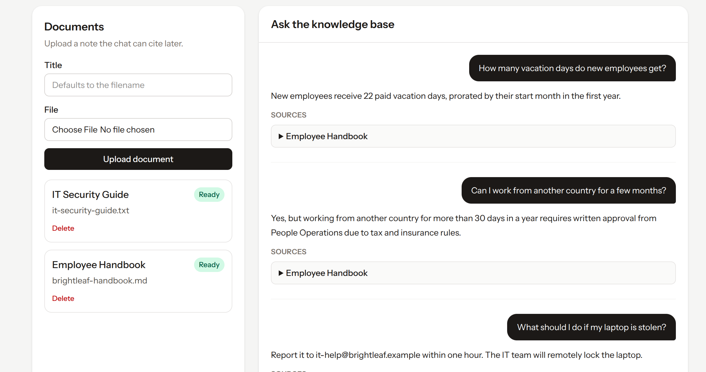
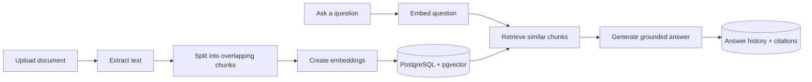

# Laravel RAG Demo

A simple RAG system. Upload documents, ask a question, and get an answer drawn only from those documents, with the source excerpts it used.

If the retrieved text does not contain the answer, the app says "I don't know".



## How it works

1. You upload a `.txt`, `.md`, or `.pdf` file (10 MB maximum). PDF support is text only; scanned pages are not read.
2. A queued job extracts the text, splits it into chunks, and stores an embedding for each chunk.
3. A question is embedded the same way. The closest chunks are loaded from PostgreSQL with pgvector.
4. Those chunks are sent to the model as context. The answer and its source excerpts are stored in the chat history.

Chunk size, overlap, embedding dimensions, and how many chunks are retrieved live in `config/rag.php`.



## Design decisions

- **pgvector inside PostgreSQL, not a separate vector database.** Documents, chunks, embeddings, and chat history live in one database, so there is one service to run and back up. Retrieval is a normal Eloquent query using `whereVectorSimilarTo`.
- **Two layers of grounding.** Retrieval only returns chunks above a minimum cosine similarity (`RAG_MIN_SIMILARITY`, default 0.3). If no chunk qualifies, the app answers "I don't know" without calling the model at all. When chunks are found, the model runs at temperature 0 with instructions to answer only from the provided context.
- **Fixed-size chunks with overlap.** Text is split into 800-character windows that overlap by 100 characters, so a fact that crosses a boundary still appears whole in one chunk. This is simpler and more predictable than sentence- or token-aware splitting, at the cost of sometimes cutting a sentence in half. Both values are configurable.
- **Ingestion runs on a queue.** Text extraction and embedding can take seconds and depend on an external API, so the upload request only stores the file and dispatches a job. The job runs after the database commit, embeds chunks in batches to stay within provider limits, retries with backoff on failure, and marks the document `ready` or `failed`. The page polls while any document is `pending`.
- **Answers keep their sources.** Each answer stores the excerpts it was based on, so you can check where it came from.
- **Tests never call OpenAI.** The Laravel AI SDK is faked in every test, while queries run against a real PostgreSQL + pgvector database.

## Packages

| Package | Role |
| --- | --- |
| [Laravel 13](https://laravel.com) | Application framework (PHP 8.5) |
| [Laravel Sail](https://laravel.com/docs/sail) | Docker environment for the app, PostgreSQL, and Redis |
| [pgvector](https://github.com/pgvector/pgvector) | Vector similarity search in PostgreSQL |
| [Laravel AI](https://laravel.com/docs/ai) | Embeddings and answers through OpenAI |
| [Inertia Laravel](https://inertiajs.com) and [Vue 3](https://vuejs.org) | The upload and question page |
| [Laravel Wayfinder](https://github.com/laravel/wayfinder) | Typed route helpers for the Vue page |
| [Tailwind CSS 4](https://tailwindcss.com) | Page styling |
| [smalot/pdfparser](https://github.com/smalot/pdfparser) | Text extraction from PDFs |

Answers use the OpenAI model set on `App\Ai\Agents\KnowledgeBase`. Embeddings use the default provider in `config/ai.php` (`openai`). Set `OPENAI_API_KEY` before uploading or asking questions.

## Requirements

- Docker, with the Docker daemon running
- An OpenAI API key

You do not need PHP or Composer on your machine.

## Setup

Install the PHP dependencies with a temporary Docker container, then create your `.env` file:

```bash
docker run --rm \
    -u "$(id -u):$(id -g)" \
    -v "$(pwd):/var/www/html" \
    -w /var/www/html \
    laravelsail/php84-composer:latest \
    composer install --ignore-platform-reqs

cp .env.example .env
```

If you already have PHP 8.5 and Composer installed, `composer install` works too.

The database settings in `.env.example` already match Sail. Add your API key to `.env`:

```dotenv
OPENAI_API_KEY=your-key
```

Keep `DB_HOST=pgsql`, because Sail reaches Postgres by the service name `pgsql`.

Start the containers, then prepare the app:

```bash
vendor/bin/sail up -d
vendor/bin/sail artisan key:generate
vendor/bin/sail artisan migrate
vendor/bin/sail npm install
vendor/bin/sail npm run dev
```

Ingestion runs on the database queue. Leave a worker running in another terminal:

```bash
vendor/bin/sail artisan queue:work
```

Open [http://localhost](http://localhost). Sail serves the app on port 80 unless `APP_PORT` is set.

## Use the app

1. On the home page, choose a `.txt`, `.md`, or `.pdf` file. The title is optional and defaults to the file name.
2. Upload it. The document moves from `pending` to `ready` automatically when the queue worker stores its chunks, or to `failed` if ingestion cannot complete.
3. Type a question and submit it. The answer is saved in the chat history with expandable source excerpts.
4. Ask something the documents do not cover. The answer is "I don't know".
5. Delete a document to remove its stored file and indexed chunks.

Uploads, deletions, and questions are rate limited by IP address to protect the AI provider quota in a public demo.

Stop the containers with `vendor/bin/sail stop`.

## Known limitations

- **No authentication.** This is a single-user demo. Anyone who can reach the app can upload, delete, and ask questions, and everyone shares one document set and chat history.
- **Text-based PDFs only.** Scanned PDFs have no text layer, so nothing is extracted from them.
- **Character-based chunking.** Chunks can split a sentence in half. Sentence- or token-aware splitting would retrieve more precisely.
- **Prompt injection.** Uploaded documents are sent to the model as context. A document containing instructions such as "ignore the rules above" could influence the answer.
- **Similarity threshold needs tuning.** The default `RAG_MIN_SIMILARITY` of 0.3 was tuned for OpenAI's `text-embedding-3-small`, the default embedding model. A different embedding model may need a different value.

## Tests

```bash
vendor/bin/sail artisan test
```
