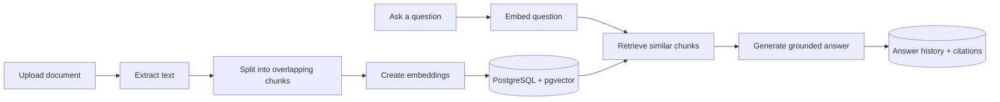

# Laravel RAG Demo

A simple RAG system. Upload a document, ask a question, and get an answer drawn only from that document.

If the retrieved text does not contain the answer, the app says "I don't know".


## How it works

1. You upload a `.txt`, `.md`, or `.pdf` file (10 MB maximum). PDF support is text only; scanned pages are not read.
2. A queued job extracts the text, splits it into chunks, and stores an embedding for each chunk.
3. A question is embedded the same way. The closest chunks are loaded from PostgreSQL with pgvector.
4. Those chunks are sent to the model as context. The answer and its source excerpts are stored in the chat history.

Chunk size, overlap, embedding dimensions, and how many chunks are retrieved live in `config/rag.php`.



## Packages

| Package | Role |
| --- | --- |
| [Laravel 13](https://laravel.com) | Application framework (PHP 8.5) |
| [Laravel Sail](https://laravel.com/docs/sail) | Docker environment for the app, PostgreSQL, and Redis |
| [pgvector](https://github.com/pgvector/pgvector) | Vector similarity search in PostgreSQL |
| [Laravel AI](https://laravel.com/docs/ai) | Embeddings and answers through OpenAI |
| [Inertia Laravel](https://inertiajs.com) and [Vue 3](https://vuejs.org) | The upload and question page |
| [Laravel Wayfinder](https://github.com/laravel/wayfinder) | Typed route helpers for the Vue page |
| [Tailwind CSS 4](https://tailwindcss.com) | Page styling |
| [smalot/pdfparser](https://github.com/smalot/pdfparser) | Text extraction from PDFs |

Answers use the OpenAI model set on `App\Ai\Agents\KnowledgeBase`. Embeddings use the default provider in `config/ai.php` (`openai`). Set `OPENAI_API_KEY` before uploading or asking questions.

## Requirements

- Docker, with the Docker daemon running
- PHP and Composer on the host, so you can install dependencies and start Sail
- An OpenAI API key

## Setup

```bash
composer install
cp .env.example .env
```

In `.env`, set the database name, user, and password, and add your API key. Keep `DB_HOST=pgsql` and `DB_CONNECTION=pgsql`. Sail reaches Postgres by the service name `pgsql`.

```dotenv
DB_DATABASE=laravel_rag_demo
DB_USERNAME=sail
DB_PASSWORD=password
OPENAI_API_KEY=your-key
```

Start the containers, then prepare the app:

```bash
vendor/bin/sail up -d
vendor/bin/sail artisan key:generate
vendor/bin/sail artisan migrate
vendor/bin/sail npm install
vendor/bin/sail npm run dev
```

Ingestion runs on the database queue. Leave a worker running in another terminal:

```bash
vendor/bin/sail artisan queue:work
```

Open [http://localhost](http://localhost). Sail serves the app on port 80 unless `APP_PORT` is set.

## Use the app

1. On the home page, choose a `.txt`, `.md`, or `.pdf` file. The title is optional and defaults to the file name.
2. Upload it. The document moves from `pending` to `ready` automatically when the queue worker stores its chunks, or to `failed` if ingestion cannot complete.
3. Type a question and submit it. The answer is saved in the chat history with expandable source excerpts.
4. Ask something the documents do not cover. The answer is "I don't know".
5. Delete a document to remove its stored file and indexed chunks.

Uploads, deletions, and questions are rate limited by IP address to protect the AI provider quota in a public demo.

This is a single-user demo with no authentication. Anyone who can reach the app can upload, delete, and ask questions.

Stop the containers with `vendor/bin/sail stop`.

## Tests

```bash
vendor/bin/sail artisan test
```
